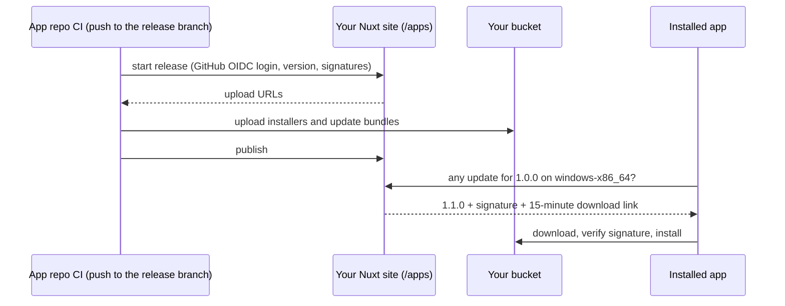

# Setup guide: from a Nuxt site to auto-updating Tauri apps

This walks through the whole flow once, end to end:

1. Add the module to your Nuxt site and give it a database and a bucket.
2. Open the admin, register your app, pick its release branch.
3. Configure the Tauri app: signing keys, the updater plugin, the endpoint.
4. Add the release workflow to the app repo.
5. Bump the version, push, and watch installed apps update.

The examples use `https://example.com` for your site, `my-org/my-app` for the app repo and `my-app` as the app ID.
Replace them with your own.



## What you need

| | |
|---|---|
| A Nuxt 4 site you deploy somewhere | Vercel, Netlify, Cloudflare, a Node server, Docker… |
| `@nuxt/ui` in that site | only for the admin UI; the update routes work without it |
| A database outside the deployment | [Turso](https://turso.tech) (libSQL) is the easiest; Postgres/Neon and Cloudflare D1 also work |
| An S3-compatible bucket | Cloudflare R2, AWS S3, Backblaze B2, MinIO… Keep it **private** |
| A Tauri v2 app on GitHub | built with Bun, `src-tauri/` at the repo root, `bun.lock` committed |

> **Why an external database?** A SQLite file inside your project folder is wiped on every redeploy, taking your
> apps, channels and tokens with it. The bucket holds the binaries; the database holds everything else.

---

## Part 1: The Nuxt site

### 1.1 Install the module

```bash
npx nuxt module add tauri-updater-backend
bun add @libsql/client          # the database driver; use pg for Postgres, nothing for D1
```

```ts
// nuxt.config.ts
export default defineNuxtConfig({
	modules: ['@nuxt/ui', 'tauri-updater-backend'],
	tauriUpdater: {
		database: {connector: 'libsql'},
		oidc: {
			// the release workflow allowed to publish; see Part 4
			allowedWorkflows: ['CTRL-Neo-Studios/tauri-updater-backend/.github/workflows/tauri-release.yml@refs/heads/main']
		}
	}
})
```

That's all the config most sites need. Everything else has defaults:

| Default | Means |
|---|---|
| `prefix: '/apps'` | update routes live at `https://example.com/apps/...` |
| `adminPath: '/__updater-admin'` | the admin UI |
| `headers: {channel: 'x-updater-channel', token: 'x-updater-token'}` | headers the app sends to pick a channel |

Pick `prefix` now and don't change it later: installed apps have the update URL baked in.

### 1.2 Create the database

With Turso:

```bash
turso db create my-updater
turso db show my-updater --url        # libsql://my-updater-<you>.turso.io
turso db tokens create my-updater     # the auth token
```

The module creates its tables (`tu_*`) itself on the first request. There's no migration step to run.

### 1.3 Create the bucket

Create a **private** bucket and an access key that can read, write, list and delete objects in it.

With Cloudflare R2: *R2 → Create bucket*, then *Manage R2 API Tokens → Create API token* with *Object Read & Write*
on that bucket. The endpoint is `https://<account-id>.r2.cloudflarestorage.com` and the region is `auto`.

Downloads and CI uploads use short-lived signed links straight to the bucket, so large installers never pass through
your site. That's why it also works on hosts with small request limits, like Vercel.

### 1.4 Set the environment variables

These are read when the server starts, never at build time, so they never end up in your build output. Set them on
your host (Vercel → *Settings → Environment Variables*, a `.env` file for local dev, and so on):

```bash
# database
NUXT_TAURI_UPDATER_DATABASE_OPTIONS_URL=libsql://my-updater-you.turso.io
NUXT_TAURI_UPDATER_DATABASE_OPTIONS_AUTH_TOKEN=eyJ...

# bucket
NUXT_TAURI_UPDATER_S3_ENDPOINT=https://<account-id>.r2.cloudflarestorage.com
NUXT_TAURI_UPDATER_S3_REGION=auto
NUXT_TAURI_UPDATER_S3_BUCKET=my-updates
NUXT_TAURI_UPDATER_S3_ACCESS_KEY_ID=...
NUXT_TAURI_UPDATER_S3_SECRET_ACCESS_KEY=...

# admin sign-in (see 1.5)
NUXT_TAURI_UPDATER_ADMIN_TOKEN=<a long random string, e.g. from `openssl rand -base64 32`>

# optional: lets the admin see private repos when you add an app
NUXT_TAURI_UPDATER_GITHUB_TOKEN=github_pat_...
```

For `NUXT_TAURI_UPDATER_GITHUB_TOKEN`, a [fine-grained token](https://github.com/settings/personal-access-tokens/new)
with read-only **Metadata** access to your repos is enough. It's only used to check repos and list branches in the
admin; publishing doesn't need it.

### 1.5 Decide who can open the admin

The admin is **closed until you choose**. Two options:

- **Admin token (quickest).** With `NUXT_TAURI_UPDATER_ADMIN_TOKEN` set, the admin asks for it at sign-in. Fine for
  getting started and for a solo developer.
- **Your own login (recommended for teams).** If your site already has accounts, let them decide. For example, with
  `nuxt-auth-utils`:

  ```ts
  // server/plugins/updater-admin.ts
  export default defineNitroPlugin((nitroApp) => {
  	nitroApp.hooks.hook('tauri-updater:authorize', async (ctx) => {
  		const {user} = await getUserSession(ctx.event)
  		if (user) {
  			ctx.allowed = user.role === 'admin'
  			ctx.actor = user.login
  		}
  	})
  })
  ```

  When your hook sets `allowed`, that's final. When it doesn't (e.g. nobody is logged in), the admin token is the
  fallback.

### 1.6 Deploy and check

Deploy the site, then:

```bash
curl -s https://example.com/apps/api/v1/apps/my-app/channels
# {"statusCode": 404, "statusMessage": "Unknown app", ...}
# ← expected: the module is running and reached its database; the app just doesn't exist yet
```

A `503 Update database is not available` means the database variables are missing or wrong; the server log has the
exact error.

> Already using NuxtHub? Keep it. This module opens its own database connection and never touches `hub:db`,
> `hub:kv` or `hub:blob`, so the two can't collide.

---

## Part 2: Register the app in the admin

Open `https://example.com/__updater-admin` and sign in.

The **Overview** page warns about anything missing (storage, allowed workflows, the shared-token sign-in). Fix those
first.

### 2.1 Add the app

*Apps → New app*:

1. **GitHub repository.** Type `my-org/my-app` or paste the repo URL. The admin checks it as you type and shows
   whether it's public or private. If a private repo shows "not found", set `NUXT_TAURI_UPDATER_GITHUB_TOKEN` (1.4);
   saving works either way.
2. **Release branch.** Pick from the list; the default branch is preselected. **Only CI runs on this branch can
   publish.** Pushes to other branches, pull requests and forks are refused, so nobody can ship an update from a
   feature branch.
3. **App ID.** Filled in from the repo name. It appears in the update URL and storage paths, so keep it once chosen.

The app starts with one public channel, `stable`.

### 2.2 Add more channels (optional)

A channel is a stream of releases. On the app page, *Add channel*:

| Want | Add |
|---|---|
| Public testers | `beta`, public, *also offers* `stable` |
| Private testers | `insider`, restricted, *also offers* `beta`, `stable` |

*Also offers* means beta users get whichever is newer, beta or stable, so they move back up to stable once it
overtakes the beta.

The channel a release lands on comes from its version: `1.3.0` goes to `stable`, `1.3.0-beta.1` goes to `beta`. The
channel must exist before you publish to it. See [Publish to beta](#publish-to-beta-or-any-channel-instead-of-stable)
in Part 5.

### 2.3 Give testers access to restricted channels (optional)

*Users & tokens → New user*, add a grant like `my-app:insider`, and copy the token. It's shown **once**; only its
hash is stored. Testers paste it into the app (3.6). Rotate or delete it here at any time; the change applies
immediately.

---

## Part 3: The Tauri app

### 3.1 Generate the signing keys

Tauri refuses any update that isn't signed with your key. Generate it once:

```bash
bunx tauri signer generate -w ~/.tauri/my-app.key
```

This creates `my-app.key` (private) and `my-app.key.pub` (public).

> **Back up the private key and its password.** If you lose it, installed apps can never be updated again: every
> user has to reinstall by hand.

### 3.2 Add the updater plugin

```bash
bun tauri add updater
bun tauri add process        # to restart the app after an update
```

This adds the crates and the JavaScript packages, and registers the plugins in `src-tauri/src/lib.rs`.

Allow the frontend to use them in `src-tauri/capabilities/default.json`:

```json
{
	"permissions": [
		"core:default",
		"updater:default",
		"process:default"
	]
}
```

### 3.3 Configure `tauri.conf.json`

```json
{
	"version": "1.0.0",
	"bundle": {
		"createUpdaterArtifacts": true
	},
	"plugins": {
		"updater": {
			"pubkey": "PASTE THE CONTENTS OF my-app.key.pub HERE",
			"endpoints": [
				"https://example.com/apps/updates/my-app/{{target}}/{{arch}}/{{current_version}}"
			]
		}
	}
}
```

- **`version`** drives everything. Bumping it is what triggers a release (Part 5).
- **`pubkey`** is the key file's *contents*, not its path.
- **`endpoints`**: keep `{{target}}`, `{{arch}}` and `{{current_version}}` exactly as written; Tauri fills them in.
  Use the exact host your site answers on (`www.` included if that's where it lives), because a redirect to
  another host drops the channel and token headers.

### 3.4 Check for updates in the app

Minimal version, run once at startup:

```ts
import {check} from '@tauri-apps/plugin-updater'
import {relaunch} from '@tauri-apps/plugin-process'

export async function checkForUpdates() {
	const update = await check()
	if (!update) return                       // up to date (the server answered 204)

	if (!confirm(`Version ${update.version} is available.\n\n${update.body ?? ''}\n\nInstall now?`)) return
	await update.downloadAndInstall()
	await relaunch()
}
```

`update.body` holds the release notes. By default they're the commit message of the push that released it.

### 3.5 Let users pick a channel (optional)

Send the channel, and the token for restricted ones, as headers on the check. Tauri resends them on the download too:

```ts
const channel = localStorage.getItem('update-channel') ?? 'stable'
const token = localStorage.getItem('update-token')

const update = await check({
	headers: {
		'x-updater-channel': channel,
		...(token ? {'x-updater-token': token} : {})
	}
})
```

Use the header names from your site's config (`headers` in 1.1). The defaults are shown.

To show a channel picker, ask the site which channels this user may use:
`GET https://example.com/apps/api/v1/apps/my-app/channels` with the same token header returns the public channels
plus the restricted ones the token grants. Call it from Rust or with `@tauri-apps/plugin-http` (allow the URL in its
`http:default` scope). A plain `fetch()` from the webview is blocked by CORS.

`localStorage` keeps the example short. For the token, `@tauri-apps/plugin-store` is a better home.

### 3.6 Test locally (optional)

You can point a dev build at a local Nuxt server, e.g. `http://localhost:3000/apps/updates/...`. Tauri only allows
plain `http://` if you also set `"dangerousInsecureTransportProtocol": true` under `plugins.updater`. Remove it before
shipping.

---

## Part 4: The release workflow

### 4.1 Add the signing secrets

In the app repo: *Settings → Secrets and variables → Actions → New repository secret*:

| Secret | Value |
|---|---|
| `TAURI_SIGNING_PRIVATE_KEY` | contents of `~/.tauri/my-app.key` |
| `TAURI_SIGNING_PRIVATE_KEY_PASSWORD` | its password, if you set one |

### 4.2 Add the workflow

```yaml
# .github/workflows/release.yml
name: Release
on:
  push:
    branches: [main]            # the release branch you chose in 2.1
  workflow_dispatch:
jobs:
  release:
    uses: CTRL-Neo-Studios/tauri-updater-backend/.github/workflows/tauri-release.yml@main
    with:
      app: my-app                       # the app ID from 2.1
      api: https://example.com/apps     # your site + prefix
    secrets: inherit
    permissions:
      contents: read
      id-token: write                   # required: this is how CI proves who it is
```

It builds Windows (NSIS installer), macOS (one universal build for Apple Silicon and Intel) and Linux (AppImage,
best-effort: a failed Linux build doesn't block the release). Then it uploads straight to your bucket and publishes.

There are no storage keys or site passwords in the app repo. CI proves who it is with a GitHub login token, and the
site accepts a publish only when **all** of these match:

- the repo is the one registered for the app;
- the run is on the app's release branch;
- the workflow file is listed in `oidc.allowedWorkflows` (1.1).

If you fork or copy the workflow, put your own path in `allowedWorkflows`, e.g.
`your-org/your-repo/.github/workflows/tauri-release.yml@refs/heads/main`.

---

## Part 5: Ship a release

1. Bump `version` in `src-tauri/tauri.conf.json`, e.g. `1.0.0` → `1.1.0`.
2. Commit and push to the release branch.
3. Watch *Actions* in the app repo. The publish step ends with
   `published my-app 1.1.0 to stable (windows-x86_64, darwin-aarch64, ...)`.
4. The release appears on the app page in the admin.

Installed apps pick it up on their next check.

**Versions in short:**
- Use strict semver: `1.2.0`, `1.3.0-beta.1`. Put a dot before prerelease numbers: `alpha.10` sorts after
  `alpha.9`, but `alpha10` sorts before `alpha9`.
- Every release needs a new, higher version. Pushing without a bump builds, then skips publishing with a notice.
  That's normal.
- A published version can never be replaced. To fix a broken release, ship the next version. Or **Yank** it in the
  admin: apps stop being offered it right away, and the channel falls back to the previous release.

### Publish to beta (or any channel) instead of stable

The **version** picks the channel: the first word after the `-` is the channel name. Nothing else changes: same
branch, same workflow, same push.

| `version` in `tauri.conf.json` | Lands on |
|---|---|
| `1.3.0` | `stable` |
| `1.3.0-beta.1` | `beta` |
| `1.3.0-insider.4` | `insider` |
| `1.3.0-rc.1` | `rc` (the app needs an `rc` channel, or the publish fails with 404) |

The channel must already exist on the app (2.2), and its name is lowercase: `1.3.0-Beta.1` looks for a channel
called `Beta` and fails. A bare number such as `1.3.0-1` has no name, so it goes to `stable`.

A typical beta cycle:

1. `1.3.0-beta.1`, push: beta users get it, stable users don't.
2. `1.3.0-beta.2`, push: beta users move up.
3. `1.3.0`, push: stable users get it. Beta users get it too, because `beta` also offers `stable` and `1.3.0` is
   newer than any `1.3.0-beta.N`.

Each version can only be published once, to one channel. There's no "promote beta to stable": ship the final version
(`1.3.0`) when the beta is good.

To send every build to one channel regardless of version, set `channel` in the workflow:

```yaml
    with:
      app: my-app
      api: https://example.com/apps
      channel: beta        # every run of this workflow publishes to beta
```

Only one branch per app may publish (2.1), so channels are chosen by version or by this input, not by branch.

### Check it yourself

```bash
# what an app on 1.0.0, Windows x64, stable would get
curl -s https://example.com/apps/updates/my-app/windows/x86_64/1.0.0
# → {"version":"1.1.0","notes":"...","url":"https://...","signature":"..."}

# already on the newest version → 204 No Content
curl -i https://example.com/apps/updates/my-app/windows/x86_64/1.1.0

# a restricted channel needs the token
curl -s -H 'x-updater-channel: insider' -H 'x-updater-token: tu_...' \
  https://example.com/apps/updates/my-app/windows/x86_64/1.0.0
```

### First-install downloads for your website

```html
<a href="https://example.com/apps/download/my-app/windows-x86_64">Download for Windows</a>
<a href="https://example.com/apps/download/my-app/darwin-aarch64">Download for macOS</a>
<a href="https://example.com/apps/download/my-app/linux-x86_64">Download for Linux</a>
```

Each link redirects to the newest installer on `stable`; add `?channel=beta` for beta. The version for a badge:
`GET https://example.com/apps/api/v1/apps/my-app/releases/latest`.

---

## Housekeeping

In the admin, under *Maintenance*:

- **Purge pending** removes releases whose CI run never finished (failed or cancelled builds), with their uploads.
- **Orphaned files** lists bucket files no release refers to. Scanning changes nothing; deleting is a separate step.

Deleting an app, channel, release or user asks you to type its name first. Deleting a release or channel also
deletes its files from the bucket.

---

## Troubleshooting

| Symptom | Cause / fix |
|---|---|
| Admin says *"The admin isn't set up yet"* | no sign-in method: set `NUXT_TAURI_UPDATER_ADMIN_TOKEN` or add the hook (1.5) |
| Admin rejects the token | it differs from `NUXT_TAURI_UPDATER_ADMIN_TOKEN`; check `.env` files, which override `nuxt.config` |
| Every route answers 503 *"Update database is not available"* | database URL/token missing or wrong; the server log has the driver's error |
| Overview says *"Storage is not configured"*, or CI fails with 503 *"Release storage is not configured"* | one of the `NUXT_TAURI_UPDATER_S3_*` variables is missing |
| CI: *"skipped: X is not newer than stable's X"* | the version wasn't bumped; normal for ordinary pushes |
| CI: 401 *"Only my-org/my-app on branch main, via an allowed release workflow, may publish"* | wrong branch, the repo in the admin doesn't match, or the workflow isn't in `allowedWorkflows` |
| CI: 401 *"GitHub Actions OIDC token has audience "x", expected "y""* | set the workflow's `audience` input to the expected value (the host's `oidc.audience`) |
| CI: 401 *"Invalid GitHub Actions OIDC token"* | the token's signature, issuer or expiry failed; check `oidc.issuer` wasn't overridden |
| CI: *"… redirects to …"*, or 401 *"Missing GitHub Actions OIDC token"* | the `api` input redirects (e.g. bare domain → `www.`), and the redirect drops the token; use the final URL |
| CI: 404 *"Unknown app or channel"* | app not registered, or the version's prerelease tag (e.g. `-rc.1`) names a channel the app lacks |
| CI: *".sig missing"* | `createUpdaterArtifacts` is off, or `TAURI_SIGNING_PRIVATE_KEY` isn't set |
| CI: 422 *"Upload incomplete"* | an upload failed midway; re-run the workflow |
| App never finds an update | check the endpoint by hand with `curl` (Part 5); make sure the host matches exactly (no redirect) |
| App on a restricted channel gets 401/403 | token missing, rotated, or without a grant for this app and channel |
| Update downloads, then fails to install | the `pubkey` in `tauri.conf.json` doesn't match the private key CI signs with |
